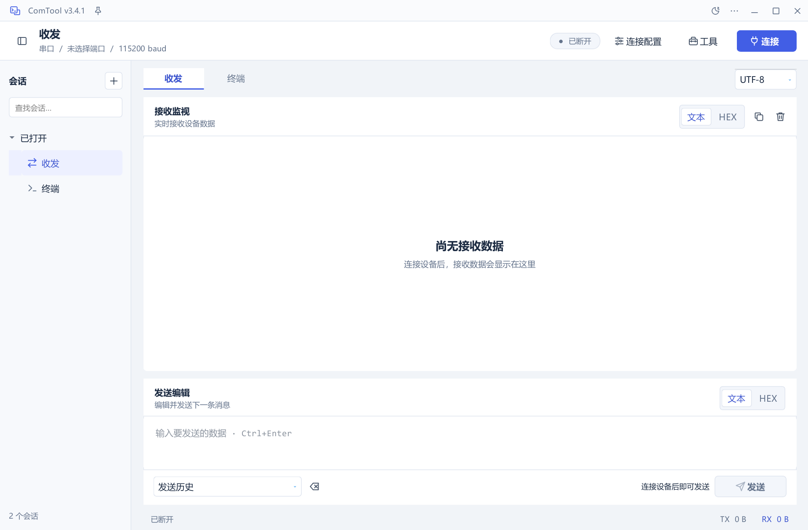
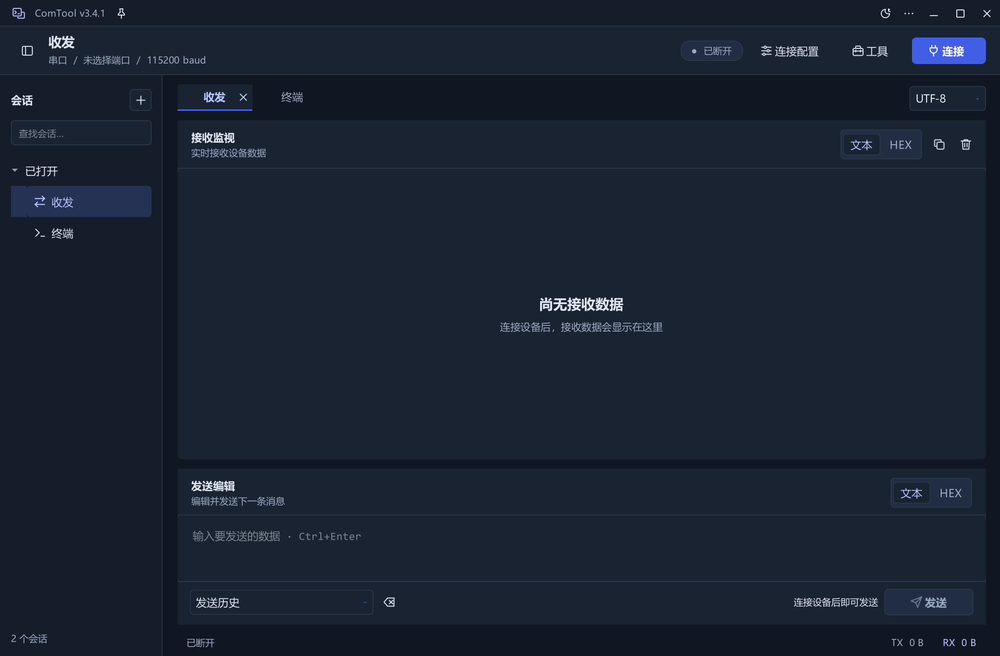

# ComTool

串口、TCP/UDP 与 SSH 通信调试工作台，提供收发、交互终端、协议与图表插件。

**Rust 预览版**：新的 Windows 通信工作台已合入 `main` 分支，代码位于 [`rust-app/`](https://github.com/leon-2050/ComTool/tree/main/rust-app)。支持串口、TCP/UDP、多会话与 SSH；Python 版继续保留。构建和功能说明见 [Rust 说明](rust-app/README.md)，实际验证与性能边界见 [测试报告](rust-app/VALIDATION.md)。协议、图表和外部 Python 插件仍由 Python 版提供。

Windows 安装版和绿色版见 [Releases](https://github.com/leon-2050/ComTool/releases)。Rust 预览版当前未签名、真实串口等场景仍待验收；自动构建与发布步骤见 [发布说明](rust-app/RELEASING.md)。

> **来源与许可**：本项目是在 [Neutree/COMTool](https://github.com/Neutree/COMTool) 基础上修改的独立维护版本，原作者为 **Neucrack**。保留上游 Git 历史和版权通知，项目源码与本次修改沿用 **LGPLv3**。修改基准为 [`8dbf97d`](https://github.com/Neutree/COMTool/commit/8dbf97d6502f33e51be60401f738c7ff6442eb9e)，上游版本 3.4.1；修改日期为 **2026-10-12 至 2026-10-13**。详见 [来源声明](NOTICE.md)、[修改记录](MODIFICATIONS.md) 和 [原许可证](LICENSE)。



## 功能

- 串口调试：文本/HEX 收发、发送历史、文件发送、自定义发送与通信记录。
- 网络调试：保留上游 TCP/UDP 客户端及服务端实现。
- SSH 终端：ANSI 亮色、256 色、RGB、字体样式与可关闭的关键词高亮。
- 多会话工作台：会话列表、搜索、分离/恢复、浅色/深色主题和统一连接入口。

本次修改重做了界面、图标与启动流程，并修复终端高 DPI、颜色和选区等问题。主要操作与验证说明见 [使用说明](README_UI_ZH.md)。

<details>
<summary>深色主题</summary>



</details>

## 从源码运行

当前 Windows 构建环境：Python 3.12.14 x64、PyQt5 5.15.11、PyInstaller 6.22.3。依赖版本见 [requirements-windows-build.txt](requirements-windows-build.txt)。

```powershell
git clone https://github.com/leon-2050/ComTool.git
cd ComTool
py -3.12 -m venv .venv
.\.venv\Scripts\python.exe -m pip install -r requirements-windows-build.txt
.\.venv\Scripts\python.exe COMTool\Main.py
```

生成 Windows 可执行文件：

```powershell
.\tool\build_windows.ps1 -Python (Resolve-Path .\.venv\Scripts\python.exe).Path
```

输出为 `dist/ComTool/ComTool.exe`。分发时保留同目录 `_internal` 文件夹。现有个人配置继续使用 `%APPDATA%\COMTool`。

## 验证范围

已检查 Windows Qt 离屏界面、会话恢复、100%/150%/200% 终端颜色、中文与复制选区、本机 SSH PTY 请求及打包程序启动。硬件串口、用户远端 SSH 和实际设备协议未做现场验证。详细范围见 [README_UI_ZH.md](README_UI_ZH.md)。

## 来源与许可证

- 上游源码：[Neutree/COMTool](https://github.com/Neutree/COMTool)，原作者 Neucrack。
- 项目许可：[原 LICENSE](LICENSE)、[LGPLv3 全文](COPYING.LESSER)、[GNU GPLv3 全文](COPYING)。
- 本次修改：[MODIFICATIONS.md](MODIFICATIONS.md)；归属与来源：[NOTICE.md](NOTICE.md)。
- 第三方依赖保留各自许可证，尤其 PyQt5 的 GPLv3／商业许可与 Qt 的许可应分别核对，参见 [第三方说明](THIRD_PARTY_NOTICES.md)。
- 本次 GitHub 提交提供源码与构建文件，没有上传本地 Windows 运行库或二进制 Release。发布打包程序时，应提供对应源码和适用的组件许可材料。

原项目文档的完整保留副本见 [英文](docs/upstream/README.MD) 与 [中文](docs/upstream/README_ZH.MD)，文件内容及其版权声明保留。上游文档里的发行、安装及升级链接指向上游项目。

## Code signing policy

免费开源签名申请已于 2026-10-22 提交，尚未获批；当前发布包仍未签名。来源、拟定审批角色及隐私行为见 [Code signing policy](CODE_SIGNING_POLICY.md)。
